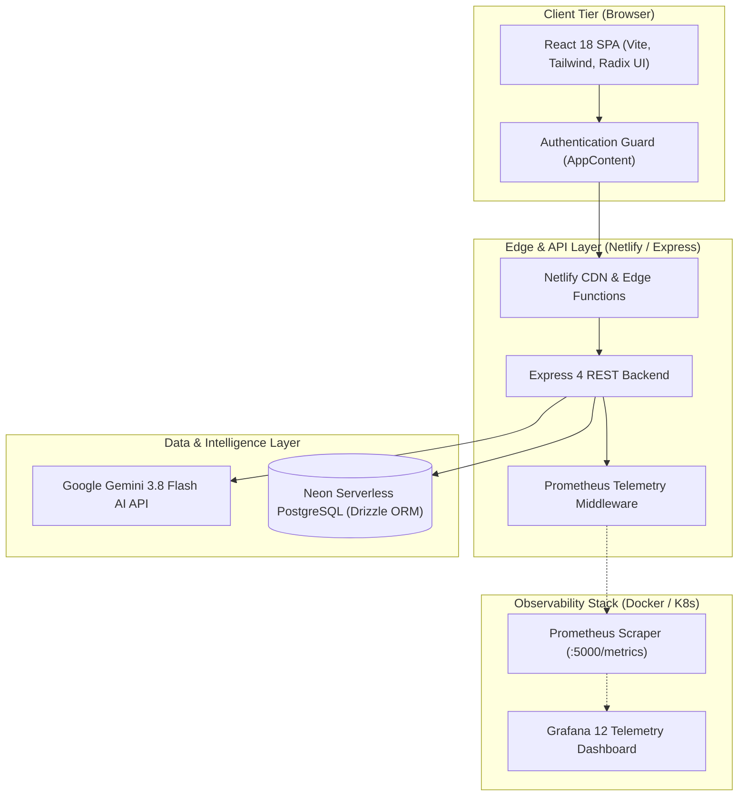

# ZenGen — AI-Powered Mental Wellness Platform

[](https://zengen-prediction-platform.netlify.app)
[](https://nodejs.org/)
[](https://www.typescriptlang.org/)
[](https://www.docker.com/)
[](https://kubernetes.io/)
[](https://prometheus.io/)
[](https://grafana.com/)
[](https://devpost.com/software/zengen-ai-powered-mental-wellness-platform)

---

## 🌐 1. Live Demonstration & Verification

The project is deployed and publicly accessible for reviewer and recruiter evaluation:

* **Production Web Application:** [https://zengen-prediction-platform.netlify.app](https://zengen-prediction-platform.netlify.app)
* **Production Health Check Probe:** [https://zengen-prediction-platform.netlify.app/health](https://zengen-prediction-platform.netlify.app/health)
* **Production API Resources Endpoint:** [https://zengen-prediction-platform.netlify.app/api/resources](https://zengen-prediction-platform.netlify.app/api/resources)
* **Hackathon Portfolio Showcase:** [ZenGen on Devpost](https://devpost.com/software/zengen-ai-powered-mental-wellness-platform)

### Reviewer Quick Test Instructions
1. Navigate to the [Live Demo](https://zengen-prediction-platform.netlify.app).
2. Unauthenticated visitors are immediately presented with the secure **Sign In / Create Account** interface.
3. Create a test account or sign in with test credentials (e.g., username: `demo_reviewer`, password: `Password123!`).
4. Once authenticated, explore the interactive features:
   * **Clinical Self-Assessments**: Guided questionnaires assessing anxiety, mood, and social wellness with scored feedback.
   * **Supportive AI Counseling**: Empathetic conversational assistance powered by Google Gemini 3.8 Flash with automated crisis detection.
   * **Resource Library**: Curated psychiatric articles and stress-reduction guides from NIMH, Mayo Clinic, and Harvard Health.
   * **Crisis Escalation**: Instant emergency support integration (988 Suicide & Crisis Lifeline, Crisis Text Line).

---

## 📖 2. Project Overview

**ZenGen** is a secure, AI-powered mental wellness web application engineered specifically for adolescents, teens, and students facing academic stress and anxiety.

* **Problem Solved:** Adolescents frequently encounter mental health friction due to stigma, limited immediate access to guidance, and overwhelming academic pressure.
* **Target Audience:** Students, young adults, educators, and mental wellness advocates.
* **Value Delivered:** Immediate, stigma-free self-assessment, clinically grounded coping mechanisms, intelligent conversational support, and automated emergency escalation protocols.

---

## ✨ 3. Key Features

- **Validated Self-Assessments**: Standardized scoring mechanisms for anxiety, mood, and social wellness with immediate actionable feedback.
- **Empathetic AI Companion**: Powered by Google Gemini 3.8 Flash, providing context-aware supportive dialogue and stress-reduction recommendations.
- **Automated Crisis Escalation**: Real-time keyword and intent detection triggers emergency intervention banners for the 988 Suicide & Crisis Lifeline and Crisis Text Line.
- **Curated Psychoeducational Content**: Verified guides and multimedia resources sourced from accredited institutions (Mayo Clinic, Johns Hopkins, NIMH).
- **Enterprise-Grade Observability**: Native Prometheus `/metrics` telemetry exporting HTTP request counts, latency histograms, error rates, and Node.js process metrics to Grafana.

---

## 🏗️ 4. How It Works & Architecture

ZenGen uses a decoupled client-server architecture deployed across modern cloud and container runtimes:



---

## 💻 5. Technology Stack

| Layer | Technologies |
| :--- | :--- |
| **Frontend** | React 18, TypeScript 5.6, Vite 6, Tailwind CSS 4, Radix UI, Lucide Icons, Wouter, TanStack Query |
| **Backend** | Node.js (20.x / 22.x), Express 4, Passport.js session auth, Serverless HTTP |
| **Database & ORM** | PostgreSQL (Neon Serverless), Drizzle ORM, Drizzle-Zod |
| **AI Integration** | Google Generative AI SDK (`gemini-3.8-flash`) with resilient fallback handling |
| **CI/CD** | GitHub Actions (CI pipeline, `kubeconform` YAML linting, KinD rolling updates) |
| **Containers & Orchestration** | Docker (multi-stage Alpine image), Kubernetes (Deployments, Probes, Services) |
| **Configuration Management** | Ansible (Playbook & Inventory for service user automation) |
| **Observability** | `@prometheus-io/client`, Prometheus 3.5, Grafana 12 |
| **Production Hosting** | Netlify Edge (CDN + Serverless API Functions) |

---

## 📸 6. Observability Evidence & Screenshots

The DevOps monitoring and orchestration stack has been validated and documented with evidence artifacts:

* **Grafana Telemetry Dashboard**: [`devops/evidence/06A-zengen-grafana-monitoring-dashboard.png`](devops/evidence/06A-zengen-grafana-monitoring-dashboard.png)  
  *Visualizes CPU utilization, memory usage, request volume, p95 latency, and error rates.*
* **Prometheus Target Health**: [`devops/evidence/06B-prometheus-zengen-target-health.png`](devops/evidence/06B-prometheus-zengen-target-health.png)  
  *Confirms active scrape health (`state: UP`) for the ZenGen application endpoint.*
* **Raw Prometheus Metrics Endpoint**: [`devops/evidence/06C-zengen-prometheus-metrics.png`](devops/evidence/06C-zengen-prometheus-metrics.png)  
  *Validates Prometheus exposition text format on `/metrics`.*

> 📖 **Complete DevOps CA-II Engineering Case Study:**  
> Detailed step-by-step documentation is available in [**`devops/README.md`**](devops/README.md).

---

## 🔒 7. Security and Privacy Architecture

ZenGen applies security best practices across all architectural layers:

1. **Server-Side Secret Management**:
   * All sensitive tokens (Google Gemini API keys, Neon database connection strings, session secrets) are securely stored in server-side environment variables.
   * No keys or secrets are embedded in client bundles or public repositories.
   * `.env` and `.env.*` files are strictly excluded via `.gitignore`.
   * A sanitized template is maintained in [`.env.example`](.env.example).
2. **Authentication & Route Isolation**:
   * Unauthenticated traffic is strictly blocked from protected views and redirected to `/auth`.
   * Sessions are securely managed with hashed credentials via Passport.js.
   * API endpoints return `401 Unauthorized` for non-session requests.
3. **Resilient AI Failure Handling**:
   * When external AI services encounter rate limits or outages, ZenGen executes a supportive fallback mechanism without leaking stack traces or internal server details.
4. **Input Validation**:
   * All API requests are strictly parsed and validated using Zod schemas before reaching business logic.
5. **Kubernetes Secret Protection**:
   * Production manifests reference external Kubernetes secrets (`zengen-secrets`), preventing hardcoded credentials in YAML definitions.

---

## 🧪 8. Project Status and Verification

All core builds, type checks, and automated test suites have been verified:

* **TypeScript Compilation:** Passed (`npm run check` → 0 errors).
* **Automated Test Suite:** Passed (`npm test` → 2/2 suites passing, covering API endpoints, wellness services, and Prometheus telemetry).
* **Production Build:** Passed (`npm run build` → Vite 6 frontend bundle + esbuild Node bundle to `dist/`).
* **Live Health Endpoint:** Verified (`GET /health` → HTTP 200 `{"status":"ok"}`).
* **Live API Resources:** Verified (`GET /api/resources` → HTTP 200 with psychiatric resource payload).
* **Live Auth Protection:** Verified (`GET /api/user` → HTTP 401 Unauthorized).

---

## ⚙️ 9. Local Execution Guide

### Prerequisites
* Node.js 20.x or 22.x
* Docker & Docker Compose (optional, for local observability stack)

### Quick Start
```bash
# 1. Install dependencies
npm install

# 2. Run TypeScript type check
npm run check

# 3. Run automated test suite
npm test

# 4. Start local development server
npm run dev
# Accessible at http://localhost:5000
```

### Run Observability Stack Locally
```bash
# Start ZenGen, Prometheus, and Grafana
docker compose -f devops/monitoring/docker-compose.yml up --build -d

# Verify containers
docker compose -f devops/monitoring/docker-compose.yml ps
```
* **Application**: `http://localhost:5000`
* **Metrics Endpoint**: `http://localhost:5000/metrics`
* **Prometheus UI**: `http://localhost:9090`
* **Grafana Dashboard**: `http://localhost:3000/d/zengen-monitoring/zengen-application-monitoring`

---

## 📄 10. Source Code and Licensing Notice

* This project is maintained as a demonstration application and portfolio artifact for academic evaluation (DevOps CA-II) and technical review.
* Source code access is maintained within restricted repositories.
* Proprietary algorithms, counseling prompts, and integration workflows are reserved.

---

## 🚀 11. Deployment Details

* **Hosting Platform:** Netlify Edge (CDN distribution + Serverless Function execution)
* **Configuration:** Configured via [`netlify.toml`](netlify.toml) with redirects mapping `/api/*`, `/health`, and `/metrics` to serverless function handlers.
* **Live Production URL:** [https://zengen-prediction-platform.netlify.app](https://zengen-prediction-platform.netlify.app)

